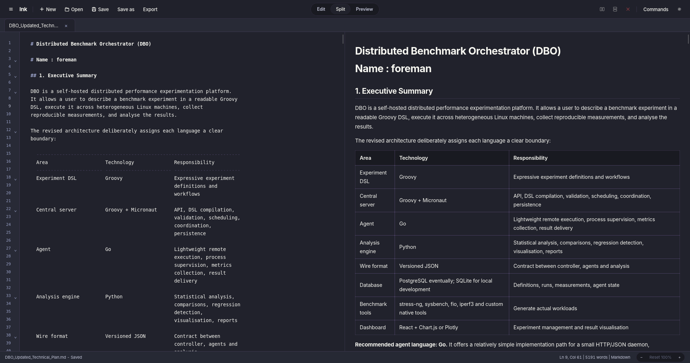
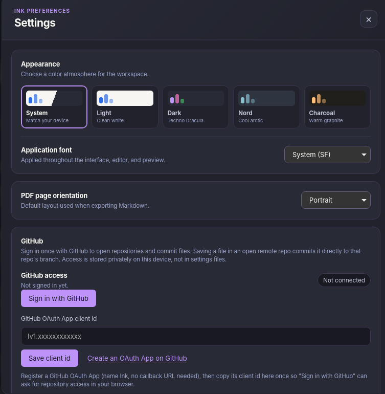

# Ink

Ink is a secure, local-first Markdown workspace for Windows, macOS, and Linux. It combines a focused Markdown editor and live preview with familiar desktop-editor navigation.



## Install

Download the latest build from the [Releases page](https://github.com/Jishnu-Prasad888/Ink/releases/latest):

| Platform | Package                                       |
| -------- | --------------------------------------------- |
| Linux    | `.deb`, `.rpm`, or `.AppImage`                |
| Windows  | `.exe` installer or `.msi`                    |
| macOS    | Build from source (see [Build](#build) below) |

On Debian or Ubuntu:

```bash
sudo dpkg -i Ink_<version>_amd64.deb
```

## Features

### Editing

- CodeMirror 6 editor with syntax highlighting, folding, search, undo, autocomplete, multiple cursors, and intelligent Markdown continuation
- Edit, Split, and Preview modes, with synced scrolling and a draggable divider between the editor and preview in Split mode
- Multi-document tabs and resizable editor groups with exclusive per-pane tabs and independent Edit/Preview controls
- Command Palette with `Ctrl+\`` / `Cmd+\``
- Right-click menu with Cut, Copy, Paste, Select All, and screenshots

### Preview

- Mermaid diagrams that follow the app theme, KaTeX math, footnotes, task lists, and highlighted code blocks
- GitHub-style tables and Pandoc multiline and simple tables, including documents converted from Word
- PDF zoom, rotation, fit-to-width, and print-ready portrait or landscape export

### Workspace

- Folder Explorer with Markdown, text, PDF, recent-file, close-folder, and native drag-and-drop support
- GitHub remote workspaces: open a repository without cloning, and commit changes on save
- In-app screenshots of an area or the whole window, copied to the clipboard or saved as PNG
- Session restoration and recently closed tabs
- Document status with cursor position, word count, and per-tab zoom controls

### Appearance

- Light, Dark (Techno Dracula), Nord, Charcoal, and System themes with application-wide font selection



### Safety

- Atomic saves, stale-file detection, and unsaved-change protection
- Sanitized previews and a restrictive Tauri content security policy
- Keyboard-accessible tabs, Explorer, dialogs, menus, and splitters

## GitHub Remote Workspaces

1. Register a GitHub OAuth App (name it Ink; no callback URL is needed) and paste its client id under **Settings → GitHub**.
2. Choose **Sign in with GitHub** and approve access in your browser.
3. Use **File: Open Remote…** in the Command Palette to open a repository.

Saving a file in a remote workspace commits it directly to that repository's branch. Credentials are stored privately on the device, not in settings files.

## Screenshots

Press `Alt+Shift+S`, or right-click and choose **Screenshot Area…**, then drag over the part of the window you want. Click or press `Enter` to capture the whole window, or `Esc` to cancel. From the result you can **Copy to clipboard** (`Ctrl/Cmd+C`) or **Save as PNG…** (`Ctrl/Cmd+S`). **Screenshot Window** in the right-click menu captures the whole window straight away.

## Shortcuts

| Shortcut             | Action                 |
| -------------------- | ---------------------- |
| `Ctrl/Cmd+N`         | New document           |
| `Ctrl/Cmd+O`         | Open documents         |
| `Ctrl/Cmd+S`         | Save                   |
| `Ctrl/Cmd+Shift+S`   | Save As                |
| `Ctrl/Cmd+W`         | Close document         |
| `Ctrl/Cmd+Shift+E`   | Export PDF             |
| `Ctrl/Cmd+Tab`       | Next document          |
| `Ctrl/Cmd+Shift+Tab` | Previous document      |
| `Ctrl/Cmd+Shift+T`   | Reopen closed document |
| `Ctrl/Cmd+B`         | Toggle Explorer        |
| `Ctrl/Cmd+\``        | Command Palette        |
| `Ctrl/Cmd+,`         | Settings               |
| `Ctrl/Cmd+1`         | Edit mode              |
| `Ctrl/Cmd+2`         | Split mode             |
| `Ctrl/Cmd+3`         | Preview mode           |
| `Alt+Shift+S`        | Screenshot area        |

### Editor

| Shortcut                            | Action                   |
| ----------------------------------- | ------------------------ |
| `Alt+↑` / `Alt+↓`                   | Move line up / down      |
| `Alt+Shift+↑` / `Alt+Shift+↓`       | Duplicate line up / down |
| `Ctrl/Cmd+Alt+↑` / `Ctrl/Cmd+Alt+↓` | Add cursor above / below |

CodeMirror provides standard editor shortcuts such as `Ctrl/Cmd+F`, undo, redo, and selection commands.

All application and editor shortcuts can be reviewed and customized in Settings.

## Development

### Requirements

- Node.js 24 or newer
- Rust stable
- Tauri v2 platform prerequisites

```bash
npm ci
npm run tauri dev
```

## Quality Checks

```bash
npm run check
cd src-tauri
cargo fmt --check
cargo test
cargo clippy --all-targets -- -D warnings
```

## Build

```bash
npm run tauri build
```

The product requirements and remaining roadmap are documented in [`docs/PRD.md`](docs/PRD.md).

## Security

Markdown files are treated as untrusted input. Raw HTML is disabled, generated preview markup is sanitized, Mermaid runs in strict mode, remote preview resources are blocked by CSP, and filesystem mutations are handled by explicit native commands.

Security issues should be reported privately to the repository owner rather than opened as public exploit reports.

## License

MIT
